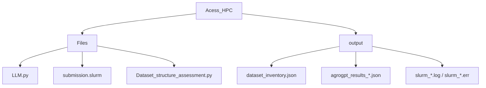

# Acess_HPC - Agricultural Image Analysis on HPC

LLM-based analysis of pre/post-defoliation agricultural imagery on Stampede3 supercomputer.

## Directory Structure

```text
Acess_HPC/
├── Files/
│   ├── submission.slurm                # SLURM job submission script
│   ├── LLM.py                          # Main inference script
│   ├── Dataset_structure_assessment.py # Python inventory report
│   ├── dataset_structure_assessment.sh # Shell inventory report
│   ├── phase2_lustre_optimization.py   # Python Lustre tuning helper
│   └── phase2_lustre_optimization.sh   # Shell Lustre tuning helper
├── docs/
│   ├── diagrams/
│   │   ├── project_structure.mmd
│   │   └── hpc_pipeline.mmd
│   └── diffs/
│       ├── dataset_structure_assessment.diff
│       └── phase2_lustre_optimization.diff
├── output/
│   ├── dataset_inventory.json          # Dataset metadata
│   ├── agrogpt_results_*.json          # Results
│   └── slurm_*.log / slurm_*.err       # Job logs
└── README.md
```

## Diagram - Project Structure



## Diagram - HPC Pipeline


## Usage

```bash
cd /work/10904/harshitha114488/LLM-test/Acess_HPC/Files
sbatch submission.slurm
```

## Utility Scripts

```bash
# Dataset inventory (Python)
python3 Dataset_structure_assessment.py

# Dataset inventory (Shell)
bash dataset_structure_assessment.sh

# Lustre optimization (Python)
python3 phase2_lustre_optimization.py

# Lustre optimization (Shell)
bash phase2_lustre_optimization.sh
```

## Monitor Jobs

```bash
squeue -u $USER
tail -f ../output/slurm_JOBID.log
```

## Re-submit Job

```bash
cd /work/10904/harshitha114488/LLM-test/Acess_HPC/Files
scancel 3004563
sbatch submission.slurm
squeue -u $USER
```

## Key Changes

- Fixed Python script header in `Dataset_structure_assessment.py`.
- Removed broken module load and switched to system `python3` in SLURM script.
- Added Lustre phase-2 optimization scripts (`.py` and `.sh`).
- Added two diff files under `docs/diffs/`.
- Added documentation and diagrams for structure and execution flow.
